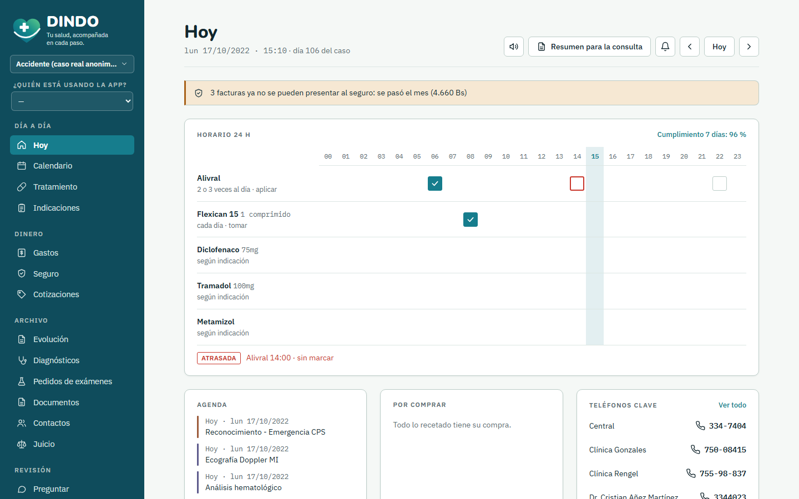
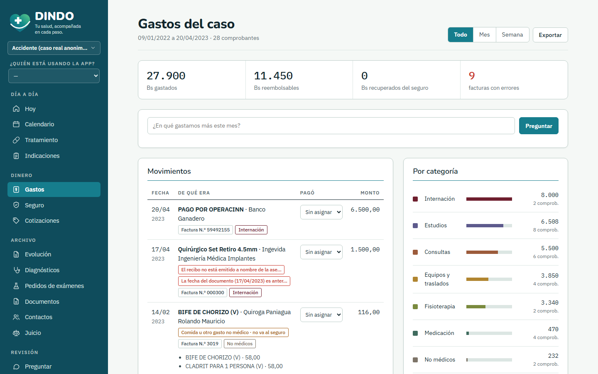
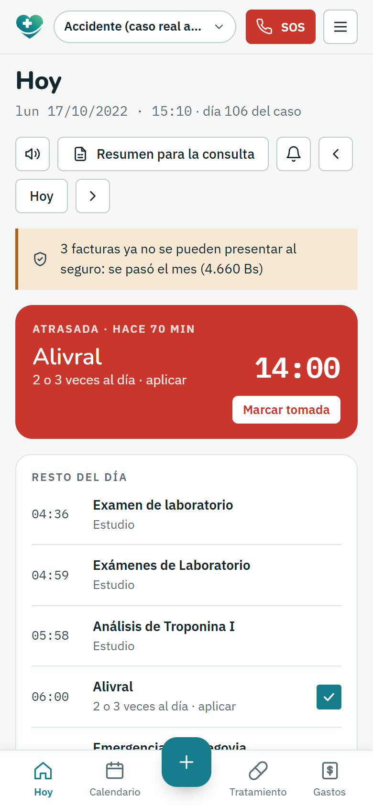
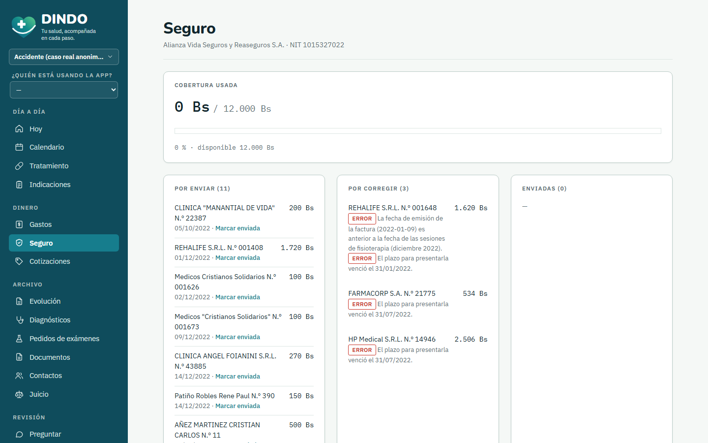
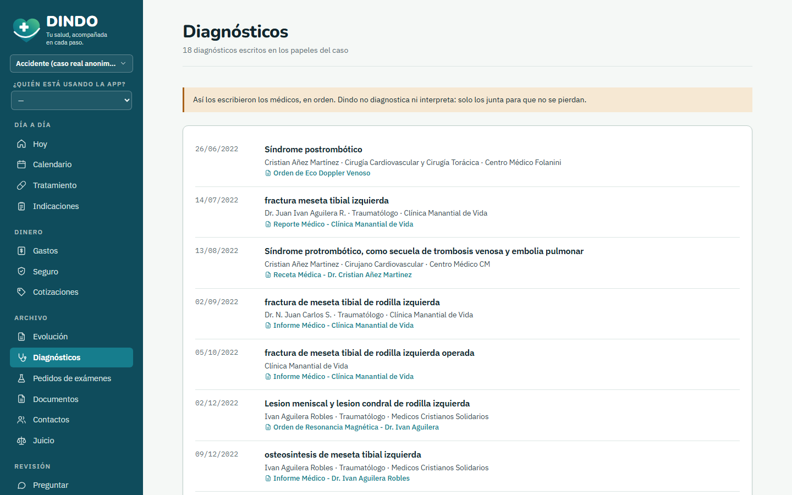

# Dindo

**Your health, with you every step.** An AI health-case manager for patients and their families, running on open models served on AMD GPUs.

Built for the **AMD Developer Hackathon: ACT III** (lablab.ai), Track 2: Health and Wellbeing.

**Live demo:** https://dindo-vgpq.onrender.com (free hosting: the first visit can take about a minute to wake up)
**Android:** install it from Chrome (⋮ → Install app) or as an APK (a Trusted Web Activity of the live site).



## The problem

In July 2022 a car hit me while I was crossing the street. Fractured left tibial plateau, surgeries, months of physiotherapy, a post-thrombotic syndrome and a lawsuit. What followed was also a paperwork ordeal:

- Handwritten prescriptions from five doctors, and never knowing which pill was due when.
- Days with 4,000 Bs of expenses and no idea what they were for.
- Invoices the insurer refused because they were issued wrong or arrived after the month closed, so part of the money was never recovered.
- Phone numbers that were nowhere when they were needed, and studies ordered for the wrong knee.

Clinics have systems. **The family has a bag of papers.** Dindo turns that bag into an organised, audited case.

## What it does

Take a photo of any paper: prescription, invoice, medical order, report, court summons, even a screenshot of a wheelchair offer. An open vision model on AMD GPUs reads it, even sideways or handwritten, and Dindo files everything where it belongs.

| Screen | What you get |
|---|---|
| **Today** | 24-hour medication grid with one-tap "taken" boxes, overdue doses in red, agenda with dates, what is still to be bought, key phones, current instructions and alerts. On the phone: a big "next dose" card. |
| **Calendar** | Every visit, test, physio session and hearing, with each treatment drawn as a bar across its days. |
| **Treatment** | Weekly grid per medication, adherence and who marked each dose; past treatments with the prescription they came from. |
| **Instructions** | Diet, activity and care indications (DO / AVOID, valid until), by date, extracted from the doctors' notes. |
| **Diagnoses** | Every diagnosis written on a medical paper, as written, with doctor and date. Dindo collects them; it never diagnoses. |
| **Test orders** | Every test that was ordered, grouped by order and doctor, with a "done" checkbox. |
| **Expenses** | Each expense with its invoice lines, category and who paid it; questions in plain language. Restaurant bills are recognised and filed apart as "non-medical", with a friendly note. |
| **Insurance** | Coverage used and left, invoices to fix, the insurer's own deadline rule ("only until the end of the invoice's month"), claim status per invoice and a claim PDF with an AI-drafted letter. |
| **Quotes** | Price quotes grouped by product, and which one was finally bought ("wheelchair: 9 options, bought at HP Medical, 2,506 Bs"). |
| **Evolution** | The case month by month, with an AI summary that cites its documents. |
| **Ask** | Ask anything about the case; every fact in the answer links to the document it comes from. |
| **Visit summary** | A 2-page PDF for the next doctor visit: what happened since the last one, current medication, adherence and pending studies. |
| **Lawsuit, contacts, alerts** | Hearings, legal contacts and an evidence-pack PDF; doctors' phones taken from stamps and notes; an emergency sheet. |

Plus reminders, "read my day aloud", family members, Spanish / English / Italian, day and night themes with several palettes, and an installable phone app.

| | |
|---|---|
|  |  |
|  |  |

### It audits the case

Dindo cross-checks every document with both the AI and deterministic rules. When both agree, the finding is marked **AI + rule**. Real errors it found in my own papers:

- An X-ray and an echo-Doppler ordered for the **RIGHT** knee when the injury is the **LEFT** knee.
- A physiotherapy invoice **dated before** the sessions it charges, which insurers reject.
- Invoices **not issued to the insurer**, line items that don't add up, receipts that aren't fiscal invoices, and invoices whose submission window already closed.

### It never guesses

When a handwritten drug name, a dose or a body side is not clearly legible, the model writes "(ilegible)" and **asks the family** ("Is the doctor's name 'V. Juan Pablo'?"). It never diagnoses, never interprets medical images and never gives medical or legal advice. Every record links back to the photo it came from.

## How it uses AMD

All AI runs on **AMD GPUs through AMD Token Factory** (OpenAI-compatible API, `https://developer.amd.com.cn/radeon/api/v1`):

| Task | Model |
|---|---|
| Reading documents (vision, handwriting, sideways photos) | `Gemma-4-31B-IT`, falling back to `Qwen3.8-Flash-Next` if the shared endpoint is busy |
| Questions about the case, evolution summary, claim letter, visit summary, evidence pack | `DeepSeek-V4-Flash` |

- The 166 documents of the demo case were all read by Gemma on AMD (about 15 s each), and the public demo shows exactly what the model extracted.
- Every call is logged and shown in the **Under the hood** screen: model, purpose, latency and tokens.
- All calls live in [`dindo/servidor/ai.py`](dindo/servidor/ai.py). Retries honour `Retry-After` on 429/5xx.
- Photos taken sideways are detected with a local OCR check ([`orientacion.py`](dindo/servidor/orientacion.py)) and only the copy sent to the model is rotated.

**Measured accuracy.** On synthetic documents with known contents, [`tools/evaluar.py`](tools/evaluar.py) scores Gemma-4-31B-IT at **98% of fields correct (55/56)** and **5 of 5 planted errors detected**.

**Why open models on AMD.** Health data should not have to leave the family's or the clinic's infrastructure. The same app runs against a dedicated AMD endpoint or on-prem AMD Instinct hardware without code changes.

## Privacy and the demo data

Token Factory's terms ask not to send identifiable health data, so the public demo uses **my real documents with personal data covered**: [`demo/caso-demo/`](demo/caso-demo/). They were anonymized locally with OCR plus manual review ([`tools/anonimizar.py`](tools/anonimizar.py)); the list of names and numbers to cover lives only on my computer. Clinics, doctors, amounts, dates and the real errors stay visible. [`demo/caso-sintetico/`](demo/caso-sintetico/) holds fictional documents for the accuracy benchmark.

## Run it

Requirements: Python 3.10+ and an AMD Token Factory key.

```bash
python -m venv .venv
.venv/Scripts/activate            # Windows  (Linux/macOS: source .venv/bin/activate)
pip install -r requirements.txt
cp .env.example .env              # add AMD_API_BASE_URL, AMD_API_KEY and the model names
mkdir data && cp demo/dindo_demo.db data/dindo.db    # the demo case as read by the AMD models
python -m uvicorn dindo.servidor.app:app --port 8000
```

Open http://localhost:8000. The demo replays one day of the case: set `DINDO_TODAY=2022-10-17` and `DINDO_TIME=15:10` in `.env`.
To start from scratch instead: `python -m dindo.servidor.seed` and then `python tools/cargar_demo.py` (the AMD models read every demo document).

With Docker (this is what the live demo runs):

```bash
docker build -t dindo .
docker run -p 8000:8000 --env-file .env dindo
```

## Project layout

```
dindo/servidor/   FastAPI app: API, AMD client (ai.py), audit rules (audit.py), ingestion, PDF packages
dindo/web/        The web app: plain HTML/CSS/JS, mobile-first, installable (PWA), ES/EN/IT, themes
demo/             Anonymized real documents, the demo database, synthetic benchmark documents
tools/            Anonymizer, demo exporter, synthetic document generator, accuracy benchmark, demo loader
docs/             Plan, progress log, extraction schema, screenshots
```

## License

MIT, see [LICENSE](LICENSE).
